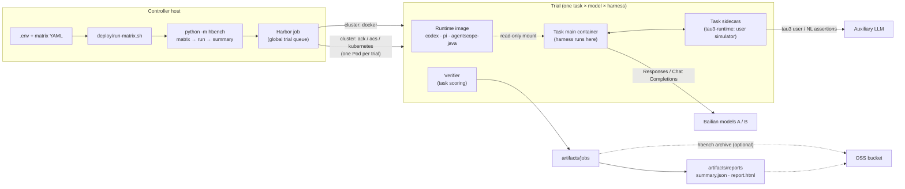

# Harness Bench

[中文](README_zh.md)

Harness Bench compares how native **Codex**, **Pi**, and **AgentScope Java** handle the same tasks with the same model.
Each harness runs its own loop. It decides when to call tools, read or write files, compact context, use memory or skills, and delegate work to subagents.

The CLI (`python -m hbench`) uses [Harbor](https://harborframework.com) 0.25.0. You can run it on a single Docker host, such as an ECS instance, or on Kubernetes, ACK, or ACS.
For setup instructions and commands for your first run, see the [operation guide](docs/operation-guide.md).

## Benchmark configuration

| Setting | Available profiles |
| --- | --- |
| Datasets | [terminal-bench](configs/benchmarks/terminal-bench.yaml) (66), [swe-bench-verified](configs/benchmarks/swe-bench-verified.yaml) (500), [tau3-bench](configs/benchmarks/tau3-bench.yaml) (375) |
| Models | [bailian-model-a](configs/models/bailian-model-a.yaml), [bailian-model-b](configs/models/bailian-model-b.yaml) (Bailian OpenAI-compatible endpoint) |
| Harnesses | [codex](configs/harnesses/codex.yaml) (Responses API), [pi](configs/harnesses/pi.yaml), [agentscope-java](configs/harnesses/agentscope-java.yaml) (Chat Completions) |
| Execution | [docker](configs/clusters/docker.yaml), [ack](configs/clusters/ack.yaml), [acs](configs/clusters/acs.yaml), [kubernetes](configs/clusters/kubernetes.yaml) |

The [Bailian matrix](configs/matrices/bailian-18.yaml) covers 18 combinations of dataset, model, and harness.
Each of the 941 tasks runs once with each model and harness pairing, for a total of 5,646 trials in one Harbor job.

| Harness | Frozen CLI version | Supported `api_formats` |
| --- | --- | --- |
| Codex | `0.167.2` | `openai_responses` only |
| Pi | `1.5.2` | `openai_chat_completions`, `openai_responses`, `anthropic_messages` |
| AgentScope Java | `1.4.0` | `openai_chat_completions` only |

Pi requires Node >=22.19.0 and uses the external `pi-mcp-adapter` `7.0.1` (Pi compatibility range `>=1.0.0,<2.0.0`).

## Architecture



The datasets supply the task images. Run `python -m hbench images build` to build the harness runtime image and the two tau3 images locally. For ACK or ACS, also push those images to a registry.

Keep credentials in the controller host’s `.env` file and out of configuration files, run plans, and Git.

## Local console

`hbench_console` adds run management and result dashboards on top of hbench without reimplementing Harbor’s scheduling or evidence chain:

```bash
python -m hbench_console --port 8090                  # read-only over existing results
CONSOLE_ALLOW_REAL_RUNS=1 python -m hbench_console    # also allow paid runs
```

It indexes `artifacts/jobs/` (or an OSS mirror directory) through `hbench summary` and shows
pass rates by harness × model × dataset plus per-task and per-trial detail. Real runs are off by
default; credentials are read from the console process environment and never stored. See the
[console execution document](docs/console-plan.md).

## Repository layout

| Path | Contents |
| --- | --- |
| `hbench/` | CLI: datasets, plan/matrix, run, summary, archive (OSS), images |
| `configs/` | Benchmark, model, harness, cluster and matrix profiles |
| `deploy/` | `run-matrix.sh` for running a benchmark matrix, plus Kubernetes manifests |
| `environments/hbench/` | Dockerfiles for the harness runtime and tau3 images |
| `adapters/agentscope-java/` | AgentScope Java harness adapter |
| `hbench_console/` | Local console: run management, dashboards, read-only evidence |
| `tests/hbench/` | Offline tests for the CLI |
| `tests/console/` | Offline tests for the console |
| `artifacts/` | Downloads, prepared datasets, run plans, job records, and reports |

Git ignores `artifacts/` by default. The `datasets/bundled-prepared` branch includes the prepared datasets in `artifacts/datasets/`.

## Status

So far we’ve run offline tests and dry runs. We haven’t run an evaluation yet, so there are no scores to report. Future scores will reflect how the harnesses perform in this setup and won’t count toward the official leaderboards.

## Further reading

- [Run an evaluation on ECS or ACK](docs/operation-guide.md)
- [Run suites and capability tasks with the legacy `eval.py` runner](docs/legacy-eval.md)
- [Agent protocol](docs/agent-protocol.md) · [Release regression](docs/release-regression.md)
- [License](LICENSE)
