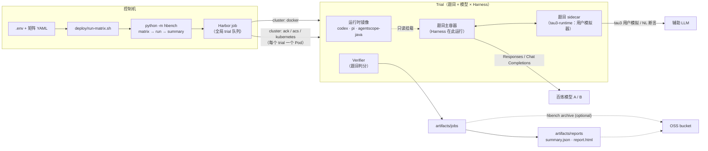

# Harness Bench

[English](README.md)

用 Harness Bench 可以给原生 **Codex**、**Pi** 和 **AgentScope Java** 配上相同的模型，让它们做同一批题，再比较各自完成得怎么样。
做题时，每个 Harness 都用自己的执行循环，按自己的方式调用工具、读写文件、管理记忆、压缩上下文，以及使用技能和子代理。

评测命令 `python -m hbench` 基于 [Harbor](https://harborframework.com) 0.25.0。
可以在一台装有 Docker 的机器（例如 ECS 实例）上运行，也可以使用 Kubernetes、ACK 或 ACS。第一次跑评测，可以从[操作指南](docs/operation-guide_zh.md)开始。

## 评测配置

| 配置项 | 可用配置 |
| --- | --- |
| 题库 | [terminal-bench](configs/benchmarks/terminal-bench.yaml)（66）、[swe-bench-verified](configs/benchmarks/swe-bench-verified.yaml)（500）、[tau3-bench](configs/benchmarks/tau3-bench.yaml)（375） |
| 模型 | [bailian-model-a](configs/models/bailian-model-a.yaml)、[bailian-model-b](configs/models/bailian-model-b.yaml)（百炼 OpenAI 兼容端点） |
| Harness | [codex](configs/harnesses/codex.yaml)（Responses API）、[pi](configs/harnesses/pi.yaml)、[agentscope-java](configs/harnesses/agentscope-java.yaml)（Chat Completions） |
| 执行环境 | [docker](configs/clusters/docker.yaml)、[ack](configs/clusters/ack.yaml)、[acs](configs/clusters/acs.yaml)、[kubernetes](configs/clusters/kubernetes.yaml) |

[bailian-18.yaml](configs/matrices/bailian-18.yaml) 把 3 个题库、2 个模型和 3 个 Harness 配成了 18 种组合。
每道题用两种模型、三个 Harness 各跑一遍，也就是每题 6 次。全部 941 道题共计 5,646 次评测（trial），由同一个 Harbor job 调度。

| Harness | 固定 CLI 版本 | 支持的 `api_formats` |
| --- | --- | --- |
| Codex | `0.167.2` | 仅 `openai_responses` |
| Pi | `1.5.2` | `openai_chat_completions`、`openai_responses`、`anthropic_messages` |
| AgentScope Java | `1.4.0` | 仅 `openai_chat_completions` |

Pi 要求 Node >=22.19.0，使用外部 `pi-mcp-adapter` `7.0.1`（Pi 兼容范围 `>=1.0.0,<2.0.0`）。

## 运行架构



题库提供题目镜像。用 `python -m hbench images build` 在本地构建 Harness 运行时镜像和两个 tau3 镜像。在 ACK 或 ACS 上运行时，还需要把这些镜像推到镜像仓库。

凭证放在控制机的 `.env` 文件里。配置文件和运行计划都不包含凭证，`.env` 也不提交到 Git。

## 可视化控制台

`hbench_console` 在 hbench 之上提供运行管理和结果看板，不重写 Harbor 的调度与证据链：

```bash
python -m hbench_console --port 8090            # 看板默认只读已有结果
CONSOLE_ALLOW_REAL_RUNS=1 python -m hbench_console   # 同时允许发起付费运行
```

控制台扫描 `artifacts/jobs/`（可指向 OSS 同步下来的镜像目录），调用 `hbench summary` 建索引，
按 harness × model × dataset 展示通过率和逐题明细。真实运行默认关闭；凭证只从控制台进程的
环境变量读取，不落库。设计与接口见 [评测控制台执行文档](docs/console-plan.md)。

## 目录结构

| 路径 | 内容 |
| --- | --- |
| `hbench/` | CLI：datasets、plan/matrix、run、summary、archive（OSS）、images |
| `configs/` | 题库、模型、Harness、集群、矩阵配置 |
| `deploy/` | 运行评测矩阵的脚本 `run-matrix.sh` 和 Kubernetes 清单 |
| `environments/hbench/` | 运行时镜像与 tau3 镜像的 Dockerfile |
| `adapters/agentscope-java/` | AgentScope Java Harness 适配器 |
| `hbench_console/` | 可视化控制台：运行管理、结果看板、只读证据 |
| `tests/hbench/` | CLI 离线测试 |
| `tests/console/` | 控制台离线测试 |
| `artifacts/` | 下载的文件、预处理后的题库、运行计划、任务记录和评测报告 |

Git 默认忽略 `artifacts/`。在 `datasets/bundled-prepared` 分支上，仓库里已经包含了 `artifacts/datasets/` 下预处理好的题库。

## 当前状态

目前只做过离线测试和试运行（dry-run），还没有实际评测成绩。后续跑出的分数反映的是各 Harness 在本项目适配环境中的表现，不计入官方榜单。

## 更多文档

- [在 ECS 或 ACK 上运行评测](docs/operation-guide_zh.md)
- [用旧版 `eval.py` 运行测试套件和能力题](docs/legacy-eval_zh.md)
- [Agent 协议](docs/agent-protocol_zh.md) · [发布回归](docs/release-regression_zh.md)
- [License](LICENSE)
