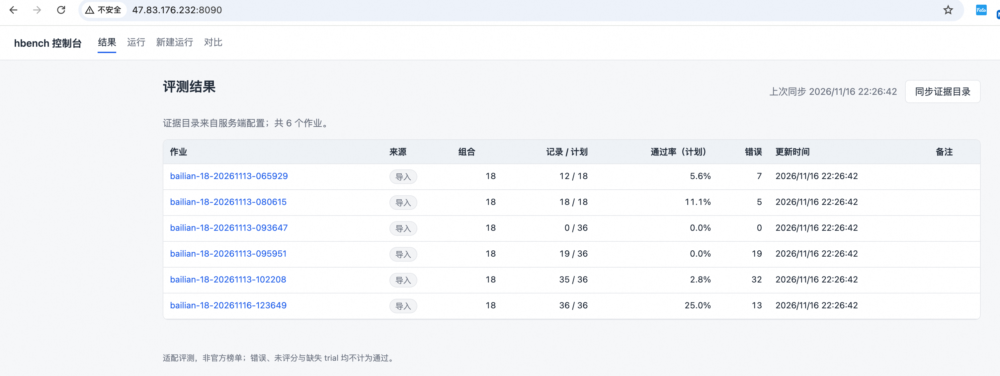
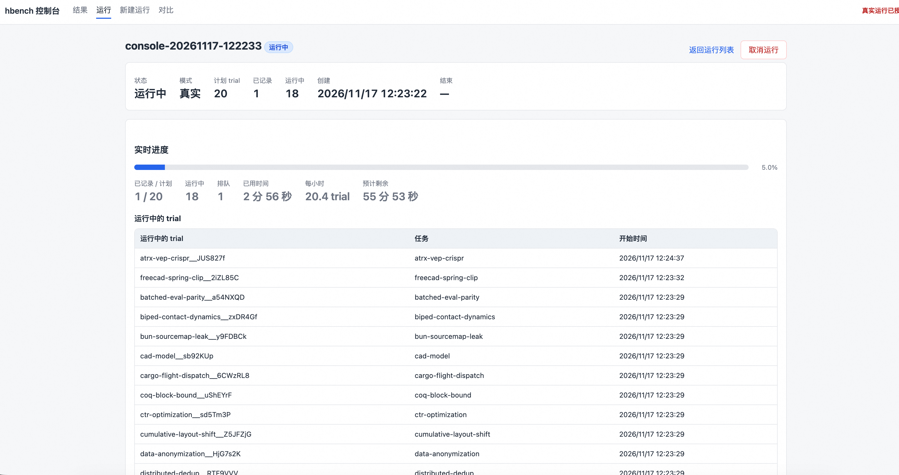
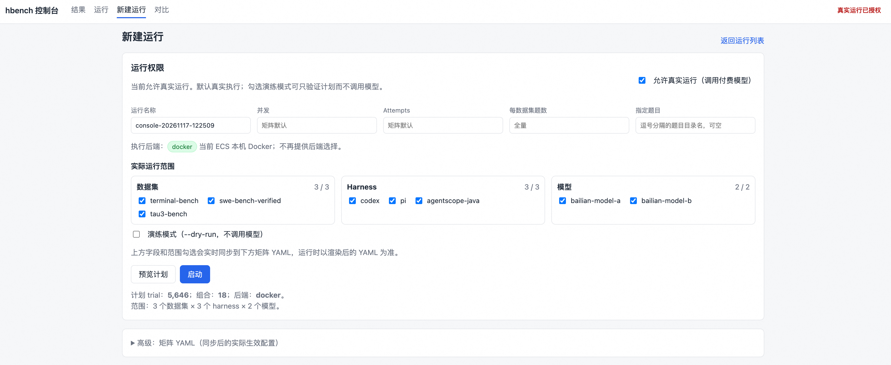

# 评测控制台（hbench_console）

`hbench_console` 是 `hbench` 的本地 Web 控制台，默认监听 `0.0.0.0:8090`，无额外前端构建链。它只读已有评测结果，也可以发起、监控和取消新的评测运行。

## 界面效果

### 结果看板

列出所有已入库的作业，显示每个作业的记录/计划数、通过率、错误数和更新时间。



### 运行详情与实时进度

运行过程中可以看到进度百分比、已记录/运行中/排队 trial、已用时间、每小时速率和预计剩余时间，并支持取消运行。



### 新建运行

选择数据集、Harness、模型后即可发起运行。页面顶部的“允许真实运行”开关控制是否调用付费模型；下方的高级矩阵 YAML 会随勾选实时同步，确保所见即所得。



## 常用操作

```bash
# 只读看板（不加载模型密钥也可启动）
python -m hbench_console

# 发起真实运行前，先加载环境变量
set -a; . ./.env; set +a
python -m hbench_console
```

- 真实运行默认关闭。在“新建运行”页打开“允许真实运行”开关即可，设置会持久化到 SQLite，重启后保留。
- 取消运行会终止 `hbench run` 进程组，并清理该运行占用的 Docker 容器、网络和卷。
- 凭证只从控制台进程的环境变量读取，控制台不保存也不显示密钥。

设计与接口细节见 [console-plan.md](console-plan.md)。
